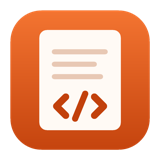
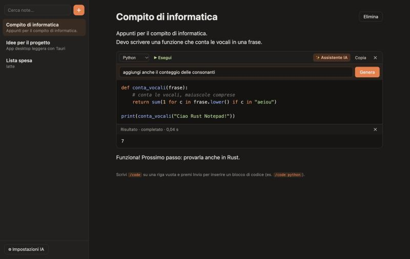

<div align="center">



# Rust Notepad

**Il blocco note che scrive, esegue e capisce il codice.**

Note veloci, blocchi di codice colorati, un pulsante per eseguirli e un assistente IA che scrive il codice al posto tuo.
Leggero (circa 7 MB), gratuito, per macOS, Windows e Linux.

[**⬇︎ Scarica l'ultima versione**](../../releases/latest)

</div>

<p align="center">
  
</p>

---

## Cosa sa fare

| | |
|---|---|
| 📝 **Note semplici** | Scrivi e basta: il salvataggio è automatico. Le note sono normali file `.md` nella cartella **Documenti → Rust Notepad**, quindi restano tue e si aprono con qualsiasi editor. |
| `</>` **Blocchi di codice** | Scrivi `/code` su una riga vuota e premi Invio. Puoi indicare subito il linguaggio: `/code python`, `/code rust`, `/code html`… Colorazione della sintassi per 15 linguaggi. |
| ▶ **Esegui il codice** | Premi **▶ Esegui** (o <kbd>⌘</kbd> <kbd>↩</kbd>) e il risultato appare sotto il blocco. Per l'HTML c'è l'anteprima direttamente nell'app. |
| ✨ **Assistente IA** | Premi **✨ Assistente IA**, descrivi cosa ti serve e l'IA scrive il codice nel blocco. Se c'è già del codice puoi chiedere di correggerlo, commentarlo o migliorarlo. Non ti piace? **Annulla**. |
| 🔍 **Ricerca** | Trova le note per titolo o per la prima riga di testo, dalla barra laterale. |
| 🌗 **Tema chiaro e scuro** | Segue automaticamente le impostazioni del sistema. |

## Installazione

Vai alla pagina [**Releases**](../../releases/latest) e scarica il file per il tuo sistema:

| Sistema | File da scaricare |
|---|---|
| **macOS** (Apple M1, M2, M3, M4…) | `Rust.Notepad_x.y.z_aarch64.dmg` |
| **macOS** (Intel) | `Rust.Notepad_x.y.z_x64.dmg` |
| **Windows** | `Rust.Notepad_x.y.z_x64-setup.exe` (oppure il `.msi`) |
| **Linux** (Ubuntu, Debian…) | `rust-notepad_x.y.z_amd64.deb` |
| **Linux** (tutte le distribuzioni) | `rust-notepad_x.y.z_amd64.AppImage` |

<details>
<summary><b>macOS: «impossibile verificare lo sviluppatore»</b></summary>

L'app non è firmata con un certificato Apple a pagamento, quindi al primo avvio macOS la blocca. È normale e si risolve una volta sola:

1. Apri il `.dmg` e trascina **Rust Notepad** in **Applicazioni**.
2. Prova ad aprirla: comparirà l'avviso. Premi **Fine**.
3. Vai in **Impostazioni di Sistema → Privacy e sicurezza**, scorri in basso e premi **Apri comunque**.

Dalla volta successiva si apre normalmente.
</details>

<details>
<summary><b>Windows: «Windows ha protetto il PC»</b></summary>

SmartScreen avvisa per le app nuove senza firma: premi **Ulteriori informazioni → Esegui comunque**.
</details>

<details>
<summary><b>Linux: AppImage</b></summary>

```bash
chmod +x rust-notepad_*.AppImage
./rust-notepad_*.AppImage
```
</details>

## Eseguire il codice

Il pulsante **▶ Esegui** usa i programmi già installati sul tuo computer. Se ne manca uno, l'app ti dice cosa installare.

| Linguaggio | Serve | Note |
|---|---|---|
| Python | `python3` | Già presente su macOS e quasi tutti i Linux |
| JavaScript | `node` | [nodejs.org](https://nodejs.org) |
| Rust | `rustc` | [rustup.rs](https://rustup.rs) |
| C / C++ | `cc` / `c++` | Sul Mac: `xcode-select --install` |
| Swift | `swift` | Sul Mac: `xcode-select --install` |
| Java | `java` (JDK 11+) | [adoptium.net](https://adoptium.net) |
| Go, PHP, Bash | `go`, `php`, `bash` | |
| HTML | niente | Anteprima dentro l'app |

> ⚠️ Il codice viene eseguito sul tuo computer con i tuoi permessi, esattamente come se lo lanciassi dal Terminale.
> Leggi sempre il codice scritto dall'IA prima di eseguirlo. Ogni esecuzione si ferma da sola dopo 15 secondi.
> I programmi che chiedono input da tastiera (`input()`, `scanf`…) ricevono un input vuoto.

## Assistente IA

Funziona **subito, senza configurare niente**: l'app usa un piccolo server gratuito che inoltra le richieste al modello **GPT-OSS 120B** su [Groq](https://groq.com). Ognuno ha **30 richieste al giorno**.

Se vuoi di più, o preferisci un altro modello, apri **⚙︎ Impostazioni IA** e scegli un servizio con la tua chiave:

| Servizio | Dove prendere la chiave | Note |
|---|---|---|
| **Groq** | [console.groq.com](https://console.groq.com) → API Keys | Gratis, circa 1.000 richieste al giorno |
| **OpenRouter** | [openrouter.ai/keys](https://openrouter.ai/keys) | Usa un modello che finisce con `:free` |
| **Google Gemini** | [aistudio.google.com](https://aistudio.google.com) | Gratis con limiti |
| **Ollama** | nessuna | IA sul tuo computer, offline |
| **Altro** | — | Qualsiasi servizio compatibile con l'API OpenAI |

La tua chiave viene salvata **solo sul tuo computer** e non viene mai inviata al server di Rust Notepad.

### Privacy

- Le note restano sul tuo computer. Niente account, niente cloud.
- Quando usi l'assistente, il testo della richiesta e il codice del blocco vengono inviati al servizio IA scelto.
- Il server di Rust Notepad non salva né il codice né il tuo indirizzo IP: per contare le richieste giornaliere conserva solo un'impronta anonima, che viene cancellata dopo 48 ore.

## Per sviluppatori

L'app è fatta con [Tauri 2](https://tauri.app): la logica è in **Rust**, l'interfaccia in HTML, CSS e JavaScript senza librerie esterne.

```
rust-notepad/
├── src-tauri/          app in Rust: note, impostazioni, IA, esecuzione del codice
│   └── src/main.rs
├── ui/                 interfaccia (index.html, style.css, app.js, syntax.js)
├── server/             server ponte per l'IA (Cloudflare Worker)
└── .github/workflows/  build automatiche per macOS, Windows e Linux
```

**Requisiti:** [Rust](https://rustup.rs) e la CLI di Tauri.

```bash
cargo install tauri-cli --version "^2" --locked
```

Su Linux servono anche alcune librerie di sistema ([elenco](https://tauri.app/start/prerequisites/#linux)).

**Avviare in modalità sviluppo**

```bash
cargo tauri dev
```

**Eseguire i test**

```bash
cd src-tauri && cargo test
```

**Creare l'app**: il risultato finisce in `src-tauri/target/release/bundle/`.

```bash
cargo tauri build
```

**Pubblicare una nuova versione**: aggiorna `version` in `src-tauri/tauri.conf.json` e in `src-tauri/Cargo.toml`, poi:

```bash
git tag v0.2.0 && git push origin v0.2.0
```

GitHub Actions compila l'app per tutti i sistemi e crea la Release con gli installer.

### Server ponte (opzionale)

Il codice è in [`server/worker.js`](server/worker.js). Per pubblicarne uno tuo su [Cloudflare Workers](https://workers.cloudflare.com), che è gratuito:

1. Crea un Worker e incolla il contenuto di `worker.js`.
2. Aggiungi il segreto `GROQ_API_KEY` con la tua chiave Groq.
3. (Consigliato) Crea un KV namespace e collegalo con il nome `LIMITS` per attivare il limite giornaliero.
4. Compila l'app indicando il tuo indirizzo:

```bash
RUST_NOTEPAD_AI_URL="https://il-tuo-worker.workers.dev/v1" cargo tauri build
```

## Licenza

[MIT](LICENSE): puoi usarlo, modificarlo e ridistribuirlo liberamente.
